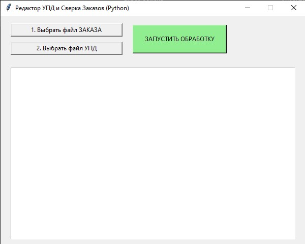

# UPD Order Reconciliation


Python desktop application for reconciling supplier order articles with line items in Universal Transfer Documents (UPD / УПД). Preview changes and save a verified `.xlsx` copy.



## 🏢 Business Problem
In B2B supply chains, vendors (e.g., Komus) frequently issue transfer documents using internal system identifiers that differ from the client's master catalog numbers. Manual reconciliation leads to high error rates and delayed ERP entries.

## 🛠 Key Features
* **Article reconciliation:** Matches supplier articles to internal order codes and previews replacements before applying them.
* **Order number insertion:** Finds the configured "Основание передачи" field and previews where the order number will be written.
* **Safe output:** Leaves source files unchanged, creates a unique output filename, and verifies the saved workbook.
* **Responsive interface:** Runs workbook processing in a background worker while keeping the Tkinter UI responsive.

## Running

Requires Python 3.9 or newer with Tkinter available. Install dependencies from the repository root:

```console
python -m pip install -r python\requirements.txt
```

Launch on Windows:

```bat
.\komus_upd.bat
```

Or run the Python entry point directly:

```console
python .\python\upd_editor.py
```

## Testing

The synthetic reconciliation tests use fictional workbooks. Run from the `python` directory:

```console
python -m pip install -r requirements-dev.txt
python -m pytest -q
```

## Workbook layout

The app reads the shared `config.json` in the repository root. It defines
1-based sheet indexes, Excel column letters, first data rows, labels, and the
row offset/column where the order number is written. If the selected order
layout contains no mappings or the configured UPD layout produces no matches,
processing stops with a configuration-oriented message.

For example, this configuration reads order mappings from columns B/C on the
first worksheet and UPD articles from column B, starting at row 17:

```json
{
  "order": {
    "sheet_index": 1,
    "first_data_row": 2,
    "internal_code_column": "B",
    "supplier_article_column": "C",
    "order_number_label": "Заказ №",
    "order_number_label_column": "B",
    "order_number_value_column": "C"
  },
  "upd": {
    "sheet_index": 1,
    "first_data_row": 17,
    "article_column": "B",
    "basis_label": "Основание передачи",
    "order_number_column": "T",
    "order_number_row_offset": -1
  }
}
```

Sheet indexes and row numbers are 1-based. Column values use Excel letters.
`order_number_row_offset` is relative to the row containing `basis_label`.

## Excel compatibility and limitations

* The application reads and writes `.xlsx` files only. Legacy `.xls` and
  macro-enabled `.xlsm` files are not supported.
* Microsoft Excel is not required to run the application. It writes standard
  `.xlsx` workbooks that can be opened by spreadsheet software supporting this
  format.
* OpenPyXL does not calculate formulas. Formula-based values in the order file
  must already have cached results; recalculate and save the workbook in a
  spreadsheet application before processing. The app does not recalculate
  formulas in the output.
* OpenPyXL does not preserve every Excel feature; in particular, unsupported
  shapes may be lost when a workbook is opened and saved. Keep a backup of
  workbooks containing embedded or advanced Excel objects. See the
  [OpenPyXL workbook-loading notes](https://openpyxl.readthedocs.io/en/stable/tutorial.html#loading-from-a-file).
